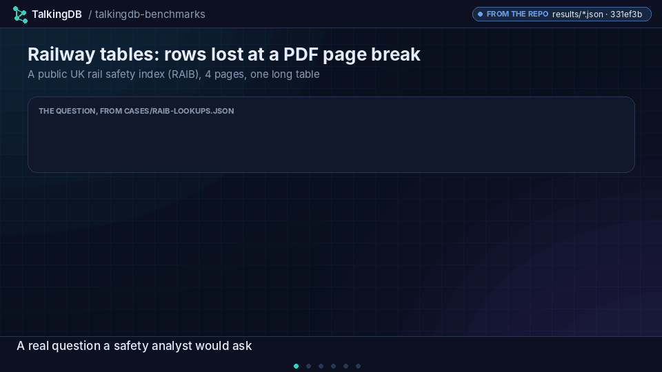
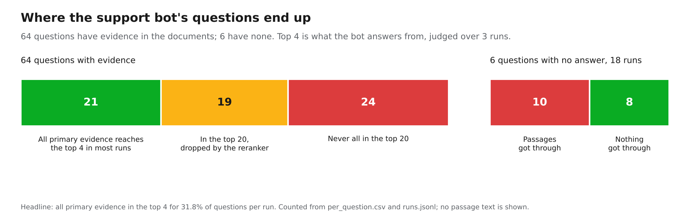

# TalkingDB benchmarks

 

Open benchmarks for [TalkingDB](https://talkingdb.io/) tools on public documents. Each one scores against exact expected evidence, without a language model as judge, and says plainly what it does not show.

| Benchmark | The question | Result | Check it yourself |
| :--- | :--- | :--- | :--- |
| [railway-tables](railway-tables) | Do tables that run across PDF pages come back complete? | Standard extraction keeps 10 of 13 expected rows; with the TalkingDB page break fix, 13 of 13 | `bash setup.sh && bash run.sh` |
| [ecommerce-rag](ecommerce-rag) | What does a customer support bot actually retrieve? | All primary evidence reaches the top 20 for 62.5% of questions, and the final top 4 for 31.8% | `python fetch_data.py && python pipeline/score.py` (dataset access needed) |
| [telecom-acronyms](telecom-acronyms) | Can a system put the row that defines an acronym's meaning in front of a model? | TalkingDB Text-to-Tree shows an accepted row for 38 of 40 questions with 61% fewer input tokens than a prompt glossary; answer quality is not measured | `python fetch_data.py && python verify.py` |

The data lives on Hugging Face under [TalkingDB](https://huggingface.co/TalkingDB): `railway-tables` and `telecom-acronyms` are public, `ecommerce-rag` is private because its documents belong to their publishers. Each folder's `fetch_data.py` downloads its files and checks every one by SHA-256. How one run works, in one picture: [setup, run, score](docs/images/how-a-benchmark-in-this-repository-runs.svg).

  

Every figure is read from the results files and benchmark READMEs in this repo, with its denominator.

## At a glance

**Railway tables.** The same question, without and with the page break fix.

**E-commerce support bot.** Where its 70 questions end up.

**Telecom acronyms.** Text-to-Tree returned the right row, and the small answer model still followed the option letter.

Free to use and open source under [AGPL-3.0](LICENSE). Rerun them, change them, or point them at your own documents, and tell us where they break. Built on the open source TalkingDB tools, starting with [module-ttt](https://github.com/TalkingDB/module-ttt).

## Support TalkingDB

If these benchmarks saved you time, please [give the repo a star](https://github.com/TalkingDB/talkingdb-benchmarks) ⭐. Stars help other developers find the project.

Found a result that looks wrong, or a document that breaks a tool? [Open an issue](https://github.com/TalkingDB/talkingdb-benchmarks/issues/new). We are always here to help and open to a conversation. Explore the TalkingDB applications at [talkingdb.io](https://talkingdb.io/#applications).
