# TalkingDB benchmarks

Open benchmarks for [TalkingDB](https://talkingdb.io/) tools, on public documents, scored exactly against expected rows and pages. No language model writes or judges the results.

Free to use and open source under [AGPL-3.0](LICENSE). Rerun them, change them, or point them at your own documents, and tell us where they break.

| Benchmark | What it tests | Result |
| :--- | :--- | :--- |
| [railway-tables](railway-tables) | Tables that run across PDF pages, on a public UK rail safety index | Standard extraction keeps 10 of 13 expected rows; with the TalkingDB page break fix, 13 of 13 |
| [ecommerce-rag](ecommerce-rag) | What a customer support [RAG](https://en.wikipedia.org/wiki/Retrieval-augmented_generation) bot retrieves, on Indian consumer law and store policies | All primary evidence reaches the top 20 for 62.5% of questions, and the final top 4 for 31.8% |

Built on the open source TalkingDB tools, starting with [module-ttt](https://github.com/TalkingDB/module-ttt).

## How every benchmark here works

<picture>
  <source media="(prefers-color-scheme: dark)" srcset="docs/images/how-a-benchmark-in-this-repository-runs-dark.svg">
  
</picture>

<sub>Diagram source: [how-a-benchmark-in-this-repository-runs.mmd](docs/diagrams/how-a-benchmark-in-this-repository-runs.mmd). Edit it and re-render with the steps in [docs/diagrams](docs/diagrams/README.md).</sub>

In words: each benchmark pins its documents and code, asks fixed questions, scores answers exactly, and keeps the results in the repository so anyone can check a figure without running anything.

## Run one

Each folder has its own three step start, in a bash terminal (Linux, macOS or [WSL](https://learn.microsoft.com/en-us/windows/wsl/about)):

```bash
git clone https://github.com/TalkingDB/talkingdb-benchmarks.git
cd talkingdb-benchmarks/railway-tables    # or ecommerce-rag
bash setup.sh
bash run.sh
```

Requirements differ per benchmark; read the folder's README first. [railway-tables](railway-tables) runs on CPU in about ten minutes. [ecommerce-rag](ecommerce-rag) needs [uv](https://docs.astral.sh/uv/), an `OPENAI_API_KEY` (or Ollama with `--local`) and a [Hugging Face](https://huggingface.co/docs) token with access to its dataset.

## How to read a result

- **Every figure has a denominator.** "10 of 13 rows" is the claim; a percentage alone is not.
- **Each result names what it compares.** A figure is only about the documents, questions and versions listed in that folder.
- **Limits are part of the result.** Each folder ends with a plain list of what the benchmark does not show.

## What these benchmarks are not

- **Not a leaderboard.** Each one tests a narrow, named problem on a few public documents.
- **Not proof for other documents.** A result on one index or one store's policies is evidence about those; try it on yours.
- **Not judged by a language model.** Scoring is exact matching against expected rows, IDs and pages.

## Add a benchmark

Copy the shape of an existing folder:

```text
your-benchmark/
├── README.md          what it tests, the result, limits, how to run
├── setup.sh, run.sh   a three step start that works from an empty folder
├── documents/         or a script that fetches pinned public documents
├── cases/             frozen questions and expected answers
├── pipeline/          the code, at pinned versions
└── results/           the saved outputs every figure is computed from
```

Before calling it reproducible, run `setup.sh` and `run.sh` from a fresh clone on a clean machine and check the numbers match.

## Further reading

- [module-ttt](https://github.com/TalkingDB/module-ttt), the document indexing used by these benchmarks
- [package-content-elementizer](https://github.com/TalkingDB/package-content-elementizer), TalkingDB's document reader
- [Open Government Licence v3.0](https://www.nationalarchives.gov.uk/doc/open-government-licence/version/3/), the licence of the UK rail documents
