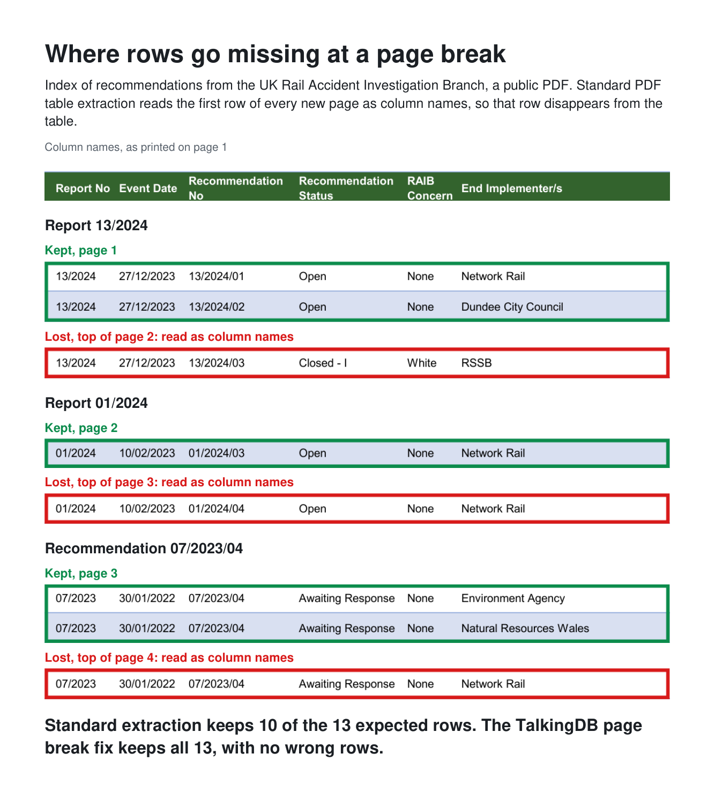
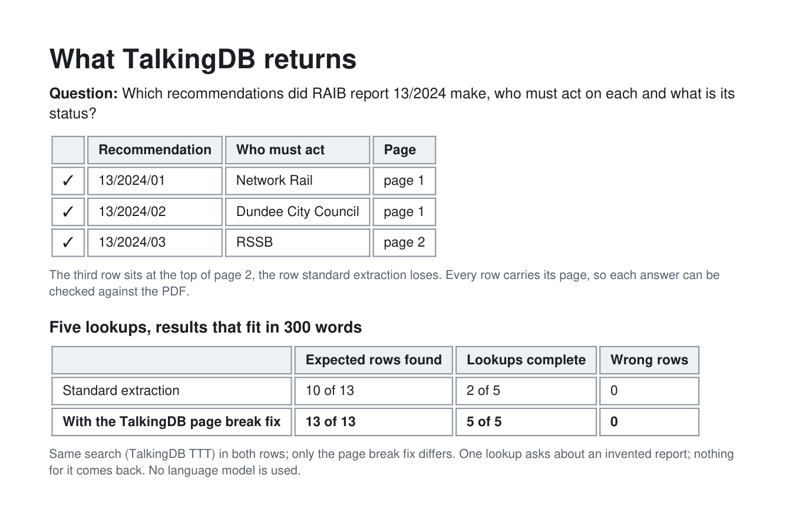
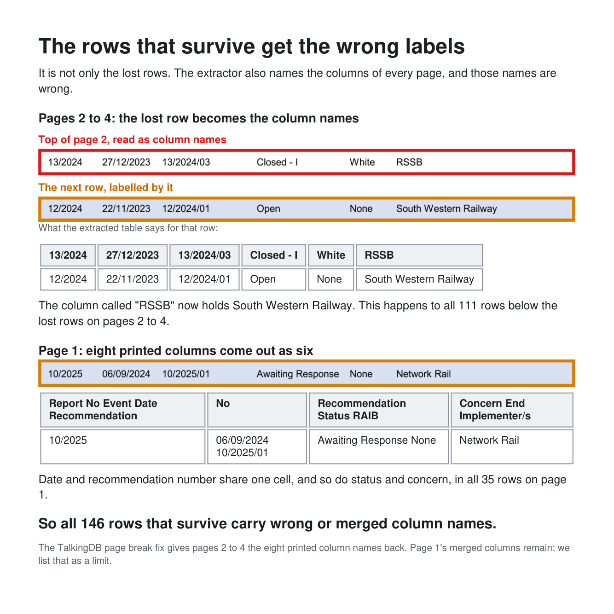
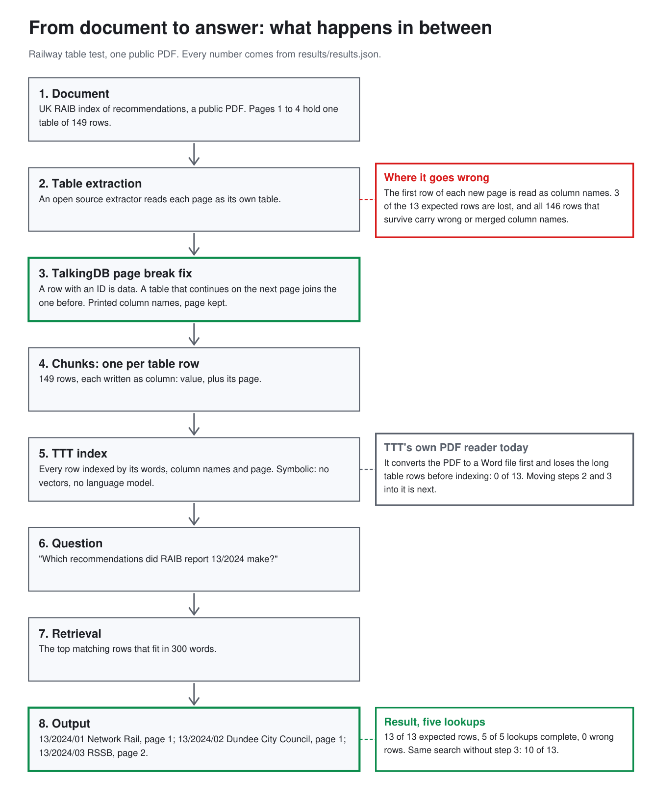

# Railway tables: rows lost at a page break

A small, open test of one problem in regulated documents: a long table that runs across PDF pages.

On a public UK rail safety document, standard PDF table extraction loses the first row of every new page. The TalkingDB page break fix keeps those rows, and [TalkingDB TTT](https://github.com/TalkingDB/module-ttt) finds them when you ask in plain English. Everything here is free to use and open source, so you can rerun it, or point it at your own documents.





It is not only the lost rows. Every row that survives standard extraction carries wrong or merged column names: on pages 2 to 4 the lost row becomes the column names for the 111 rows below it, and on page 1 eight printed columns come out as six. The page break fix gives pages 2 to 4 their printed column names back; page 1 stays merged (limit 3).



## The result

Five lookups on pages 1 to 4 of the index, 13 expected rows ([cases](cases/raib-lookups.json), [full results](results/results.json)).

| | Rows that survive extraction | Rows TTT returns within 300 words | Lookups complete | Wrong rows |
| :--- | :--- | :--- | :--- | :--- |
| Standard extraction | 10 of 13 | 10 of 13 | 2 of 5 | 0 |
| With the TalkingDB page break fix | **13 of 13** | **13 of 13** | **5 of 5** | **0** |

Same search in both rows. The only difference is the page break fix, so the three missing rows are lost at extraction, before any search runs.

## The documents

Both are public UK government publications, used under the [Open Government Licence v3.0](https://www.nationalarchives.gov.uk/doc/open-government-licence/version/3/). Contains public sector information licensed under the Open Government Licence v3.0.

| Document | What it tests | Source | SHA-256 |
| :--- | :--- | :--- | :--- |
| [Index of RAIB recommendations](documents/raib-recommendations-index.pdf), Rail Accident Investigation Branch, pages 1 to 4 | One table running across many pages; several rows per report; a recommendation with three organisations that must act | [GOV.UK](https://www.gov.uk/government/publications/index-of-raib-recommendations) | `e07edb0f606e86cbdc2e75e845703251fb484f8952f3df6ab0a8000ee82e706f` |
| [Passenger rail usage, October to December 2025](documents/orr-passenger-rail-usage-oct-dec-2025.pdf), Office of Rail and Road | Questions whose answer needs a section named elsewhere, such as Annex 1 ([questions](cases/orr-questions.json)) | [ORR data portal](https://dataportal.orr.gov.uk/media/2hto1os3/passenger-rail-usage-oct-dec-2025.pdf) | `aa769ae7dac8525a3625dc9db3a01486431313b30d8d0d74700b9df173351a10` |

## How we tested, in plain words



1. **Read the tables.** An open source PDF table extractor reads pages 1 to 4: no OCR, accurate table mode, CPU only ([extract.py](pipeline/extract.py); exact version in [requirements-extract.txt](requirements-extract.txt)). Its output is saved in [results/extraction-raib-pages-1-4.json](results/extraction-raib-pages-1-4.json), so you can check every later step without running it.
2. **Fix the page breaks.** The extractor marks the first row of each new page as column names. A row that holds a row ID, here a recommendation number such as `13/2024/03`, is kept as data whatever that mark says, and a table on the next page joins the one before it when its first row is data ([join_pages.py](pipeline/join_pages.py)).
3. **Index and ask.** TalkingDB TTT indexes every row with its column names and the page it came from, then answers five plain English questions, such as "Which recommendations did RAIB report 13/2024 make, who must act on each and what is its status?" ([ask.py](pipeline/ask.py)).
4. **Score exactly.** A row counts only with the exact recommendation number, the right organisation that must act and the right page. One lookup asks about a report that does not exist; any row returned for it fails. Only the results that fit in 300 words count. No language model writes or judges anything ([score.py](pipeline/score.py)).

| Lookup | Expected rows (recommendation, who must act, page) |
| :--- | :--- |
| Report 13/2024 | /01 Network Rail p1; /02 Dundee City Council p1; /03 RSSB p2 |
| Report 01/2024 | /01, /02, /03 Network Rail p2; /04 Network Rail p3 |
| Report 14/2023 | /01 VTG p3; /02 GB Railfreight p3; /03 RSSB p3 |
| Recommendation 07/2023/04 | Environment Agency p3; Natural Resources Wales p3; Network Rail p4 |
| Report 99/1999, invented | Nothing |

## Run it yourself

Linux or WSL, with `git` and [uv](https://docs.astral.sh/uv/). CPU only; setup takes about ten minutes the first time.

```bash
git clone https://github.com/TalkingDB/talkingdb-benchmarks.git
cd talkingdb-benchmarks/railway-tables
bash setup.sh
bash run.sh
```

`run.sh` runs the self checks, the five lookups through TTT, rewrites `results/results.json` and redraws the two images. Only want the first part? `python3 pipeline/benchmark.py` needs nothing but Python 3.

## Try it on your own documents

```bash
bash run.sh your.pdf "your question" --row-id "PATTERN" --columns "Name 1,Name 2,Name 3"
```

`--row-id` is a regular expression for the ID each data row carries. Examples: `\d{2}/\d{4}/\d+` for these recommendations, `REQ-\d+` for a requirements register, `\d+(\.\d+)+` for clause numbers. `--columns` names the columns of the widest table layout. You get the top rows with their page, so you can check each one against your PDF.

If it fails on your document, we would like to see where. Please [open an issue](https://github.com/TalkingDB/talkingdb-benchmarks/issues) with the page and what you expected.

## Limits, plainly

1. One document, four pages, five lookups, 13 rows. A development set, not a general accuracy figure.
2. The fix finds data rows by the row ID you give. A different table with the same ID format that starts at the top of the next page would be joined too.
3. When pages come out with different column counts (page 1 here has 6 columns, later pages 8), rows keep their cells in order, so column names may not line up on the narrower page. The values and the page are still right.
4. TTT's own PDF reader loses these rows today, which is why step 1 uses an open source extractor. We are fixing that.
5. Retrieval only: nothing writes an answer. The ORR questions are included, but their runner is not in this release; today TTT finds the full evidence for 4 of the 6.

## Files

| Path | What it is |
| :--- | :--- |
| `documents/` | The two public PDFs |
| `cases/` | The five lookups with expected rows, and the six ORR questions |
| `pipeline/extract.py` | Step 1, read tables from a PDF |
| `pipeline/join_pages.py` | Step 2, the page break fix, with a self check |
| `pipeline/ask.py` | Step 3, index rows in TTT and ask |
| `pipeline/score.py` | Exact scoring, with a self check |
| `pipeline/benchmark.py` | Runs the five lookups with and without the fix |
| `pipeline/make_images.py` | Draws the two images from the PDF and the results |
| `results/` | Saved extraction output and the results |
| `setup.sh`, `run.sh`, `TTT_COMMITS.txt` | Setup and run; TTT is pinned to the commits listed |

Built by Aaron Sequeira at [TalkingDB](https://talkingdb.io/). Code under [AGPL-3.0](../LICENSE).
