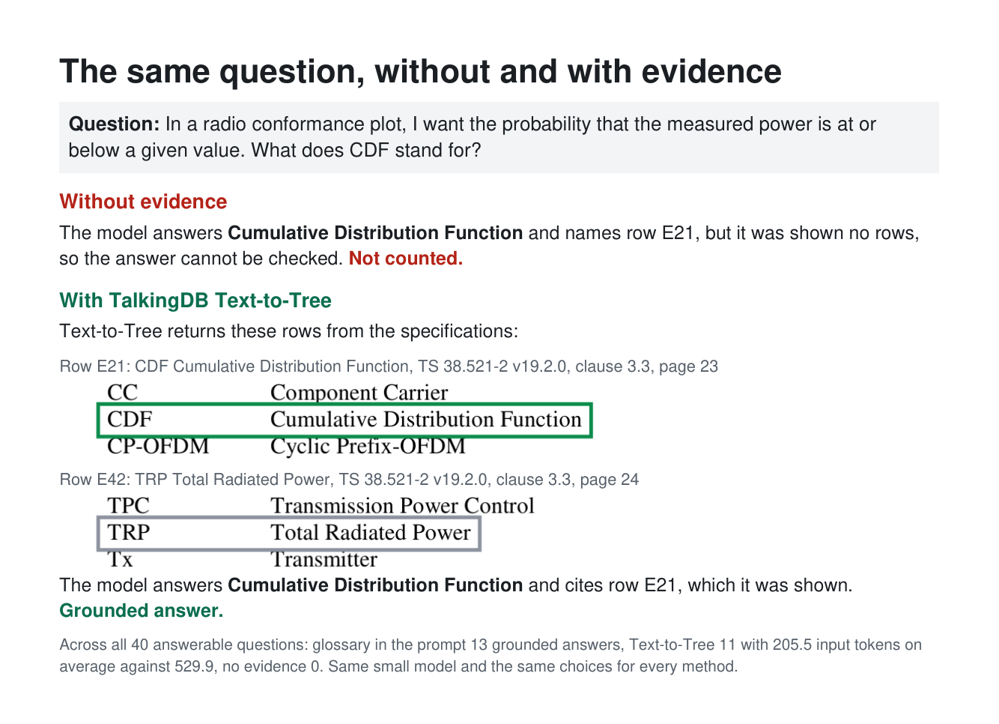
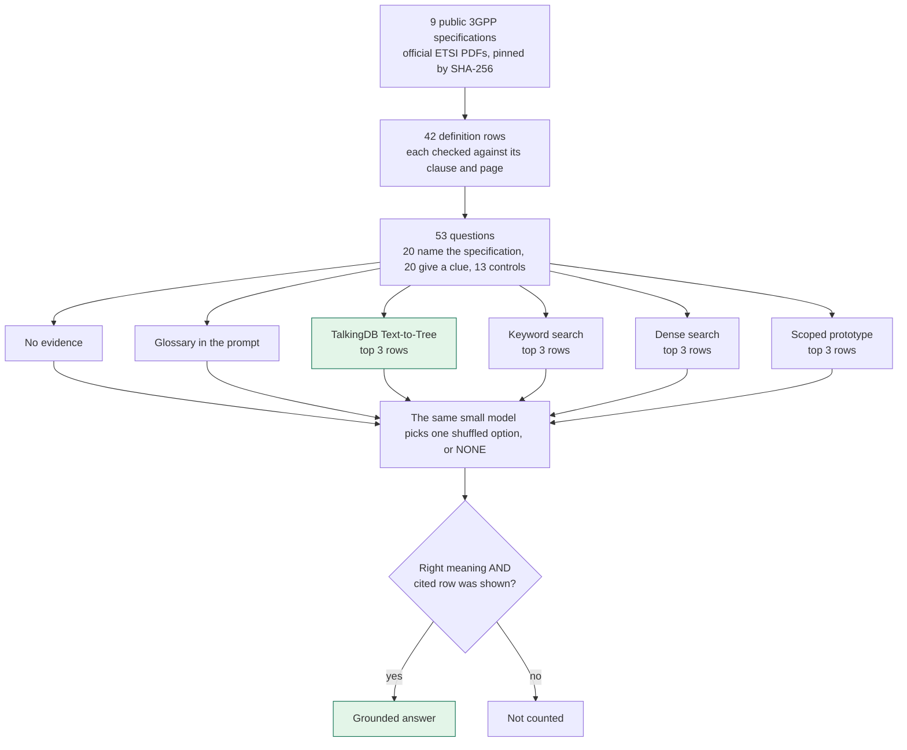
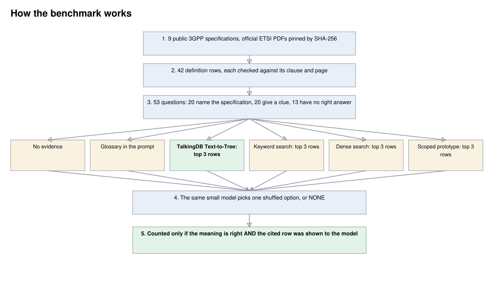
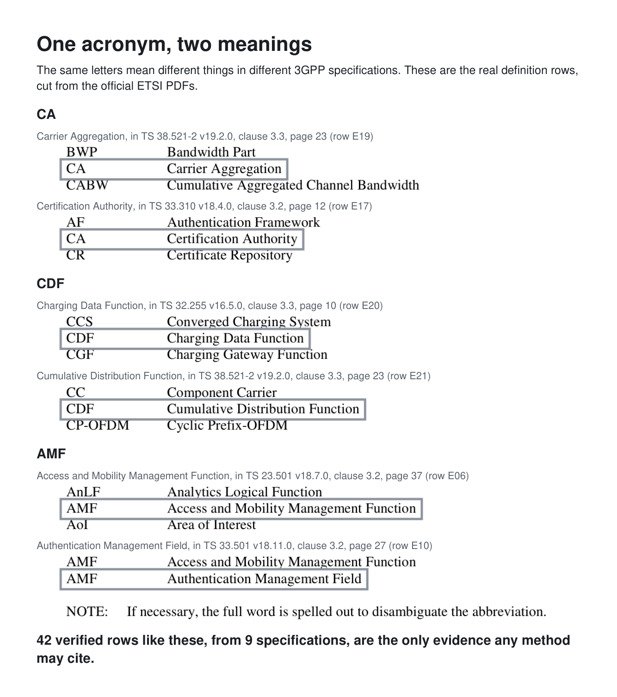
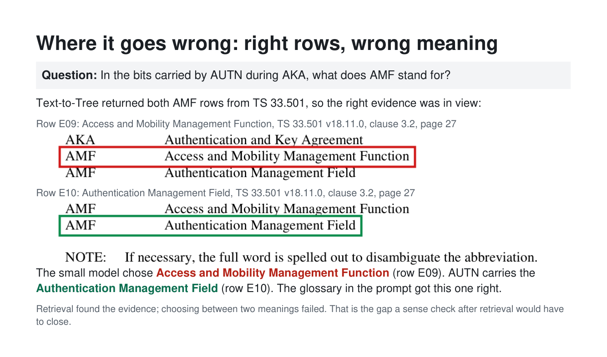

# Telecom acronyms: pick the right meaning, and cite it

One acronym can mean two different things in two 3GPP specifications. Can a system choose the right expansion and point to the specification row that supports it?



**In one line:** with the three rows TalkingDB Text-to-Tree returns, a small model gives **11 of 40** grounded answers using **205.5** input tokens on average. Putting the glossary in the prompt gives **13 of 40** with **529.9** tokens. That is 61% fewer tokens for 2 fewer grounded answers, a gap this small test cannot tell apart from chance.

## Try it in three steps

```bash
git clone https://github.com/TalkingDB/talkingdb-benchmarks.git && cd talkingdb-benchmarks/telecom-acronyms
python -m pip install -r requirements.txt && python fetch_data.py && python sources.py --fetch --model
python -m unittest && python benchmark.py --out results/repeat
```

You need Python 3.13 and `curl`. Step 2 downloads the per question results from [Hugging Face](https://huggingface.co/datasets/TalkingDB/telecom-acronyms), the nine specification PDFs from ETSI and the small answer model, and checks every file by SHA-256. Step 3 runs the unit tests, then reruns five methods on the 53 evaluation questions on your CPU. Compare `results/repeat/summary.json` with [results/evaluation/summary.json](results/evaluation/summary.json). Dense search and Text-to-Tree need one more setup each, under [Run it yourself](#run-it-yourself).

## How it works



1. **Documents.** Nine 3GPP specifications, the official ETSI editions, each pinned by its SHA-256 in [sources.json](sources.json).
2. **Evidence.** 42 definition rows (acronym, expansion, clause, page) in [definitions.json](definitions.json). `sources.py` checks every row against its page in the PDF.
3. **Questions.** 53 evaluation questions in 10 acronym families: 20 name the specification, 20 give only a domain clue, 13 are controls where the right move is to decline. 27 development questions in 5 other families stay apart.
4. **Methods.** Each method shows the model at most three rows, except the two glossary methods, which show the glossary itself. The same small model then picks one shuffled option, or NONE.
5. **Score.** An answer counts only if the meaning is right and the row it cites was actually shown to the model. No language model judges anything.



## The problem: one acronym, two meanings



These are the real rows from the specifications. A system that has seen only one of them can answer with confidence and still pick the wrong meaning. A system that cites its row can be checked.

## The result


| Method | Grounded answers, out of 40 | Correct declines, out of 13 | Mean input tokens |
| :--- | ---: | ---: | ---: |
| No evidence | 0 | 3 | 139.9 |
| Glossary in the prompt | **13** | 3 | 529.9 |
| **TalkingDB Text-to-Tree** | 11 | 3 | **205.5** |
| Full glossary | 12 | 3 | 629.1 |
| Keyword search (BM25) | 11 | 3 | 218.0 |
| Dense search (BGE small) | 12 | 3 | 218.9 |
| Scoped prototype | 12 | 3 | 217.4 |

1. Text-to-Tree found an accepted source among its top three rows for **38 of 40** answerable questions. The two misses were both named SCS questions. Against the glossary it had 0 paired wins, 2 losses and 38 ties; the family bootstrap interval is −12.5 to 0 percentage points. [Text-to-Tree summary](results/ttt/scored/summary.json) · [rows it returned](https://huggingface.co/datasets/TalkingDB/telecom-acronyms/blob/main/results/ttt/rankings.json) · [its 53 decisions](https://huggingface.co/datasets/TalkingDB/telecom-acronyms/blob/main/results/ttt/scored/per-case.jsonl)
2. Keyword search and the scoped prototype put an accepted row in their first three for all 40 answerable questions. Even with that evidence in view, the model often chose the wrong meaning or declined. Every method guessed on 10 of 13 controls, so a production answer would also need a check that the cited row applies.
3. On the 20 named questions the glossary and the scoped prototype each got 7 right; on the 20 clue questions the glossary got 6 and the prototype 5.
4. The [summary](results/evaluation/summary.json) has the wrong expansions, citation errors, results by question type, paired results and local timing. The [318 individual decisions](https://huggingface.co/datasets/TalkingDB/telecom-acronyms/blob/main/results/evaluation/per-case.jsonl) record the rows shown and the option chosen. The run made zero paid API calls.

## Where it goes wrong



On AMF-04, Text-to-Tree returned both AMF rows from TS 33.501, so the right evidence was in view, and the small model still chose the other meaning. Retrieval found the evidence; choosing between two meanings failed. That is the step a sense check after retrieval would have to fix.

## Questions and expected answers

Ten of the 53 evaluation questions, as written in [cases/evaluation.json](cases/evaluation.json). Every source row links to its page in the official PDF.

| Case | Kind | Question | Expected answer | Source row |
| :--- | :--- | :--- | :--- | :--- |
| AF-01 | Names the specification | In TS 23.501, what does AF stand for? | Application Function | [E03, TS 23.501 clause 3.2, page 37](https://www.etsi.org/deliver/etsi_ts/123500_123599/123501/18.07.00_60/ts_123501v180700p.pdf#page=38) |
| CA-01 | Names the specification | In TS 38.521-2, what does CA stand for? | Carrier Aggregation | [E19, TS 38.521-2 clause 3.3, page 23](https://www.etsi.org/deliver/etsi_ts/138500_138599/13852102/19.02.00_60/ts_13852102v190200p.pdf#page=24) |
| CA-02 | Gives a clue | The handset combines two component carriers to increase its usable bandwidth. What does CA stand for? | Carrier Aggregation | [E18, TS 38.331 clause 3.2, page 34](https://www.etsi.org/deliver/etsi_ts/138300_138399/138331/18.04.00_60/ts_138331v180400p.pdf#page=35); [E19, TS 38.521-2 clause 3.3, page 23](https://www.etsi.org/deliver/etsi_ts/138500_138599/13852102/19.02.00_60/ts_13852102v190200p.pdf#page=24) |
| CDF-04 | Gives a clue | In a radio conformance plot, I want the probability that the measured power is at or below a given value. What does CDF stand for? | Cumulative Distribution Function | [E21, TS 38.521-2 clause 3.3, page 23](https://www.etsi.org/deliver/etsi_ts/138500_138599/13852102/19.02.00_60/ts_13852102v190200p.pdf#page=24) |
| AMF-04 | Gives a clue | In the bits carried by AUTN during AKA, what does AMF stand for? | Authentication Management Field | [E10, TS 33.501 clause 3.2, page 27](https://www.etsi.org/deliver/etsi_ts/133500_133599/133501/18.11.00_60/ts_133501v181100p.pdf#page=28) |
| MSK-04 | Gives a clue | In the 5G security procedure for EAP authentication, the key material exported by EAP includes MSK. What is its expansion? | Master Session Key | [E29, TS 33.501 clause 3.2, page 28](https://www.etsi.org/deliver/etsi_ts/133500_133599/133501/18.11.00_60/ts_133501v181100p.pdf#page=29) |
| SCS-04 | Gives a clue | The radio conformance table lists numerology values of 60 kHz and 120 kHz. What does SCS measure? | Subcarrier Spacing | [E39, TS 38.331 clause 3.2, page 36](https://www.etsi.org/deliver/etsi_ts/138300_138399/138331/18.04.00_60/ts_138331v180400p.pdf#page=37); [E40, TS 38.521-2 clause 3.3, page 24](https://www.etsi.org/deliver/etsi_ts/138500_138599/13852102/19.02.00_60/ts_13852102v190200p.pdf#page=25) |
| MRB-03 | Names the specification | In TS 38.331, what does MRB stand for? | MBS Radio Bearer | [E27, TS 38.331 clause 3.2, page 36](https://www.etsi.org/deliver/etsi_ts/138300_138399/138331/18.04.00_60/ts_138331v180400p.pdf#page=37) |
| PSI-05 | Control: no context | A note mentions PSI but gives no specification or other context. What does PSI stand for? | NONE: the specifications define more than one meaning | None |
| AS-06 | Control: not in scope | Using only the supplied glossary for TS 33.310, what is the expansion of AS? | NONE: TS 33.310 does not define AS | None |

## The documents

| Specification | Edition | What it covers |
| :--- | :--- | :--- |
| [TS 23.228](https://www.etsi.org/deliver/etsi_ts/123200_123299/123228/18.06.00_60/ts_123228v180600p.pdf) | v18.6.0 | IMS architecture, voice and multimedia sessions, SIP identities, application servers, bearer services and media resource allocation |
| [TS 23.501](https://www.etsi.org/deliver/etsi_ts/123500_123599/123501/18.07.00_60/ts_123501v180700p.pdf) | v18.7.0 | 5G core architecture, network functions, application traffic steering, registration, mobility, device identity and subscriber identity |
| [TS 24.501](https://www.etsi.org/deliver/etsi_ts/124500_124599/124501/18.08.00_60/ts_124501v180800p.pdf) | v18.8.0 | Non Access Stratum signalling, registration, residential gateway provisioning, multicast service keys and NAS integrity protection |
| [TS 32.255](https://www.etsi.org/deliver/etsi_ts/132200_132299/132255/16.05.00_60/ts_132255v160500p.pdf) | v16.5.0 | 5G charging architecture, charging records, charging events and metering |
| [TS 33.310](https://www.etsi.org/deliver/etsi_ts/133300_133399/133310/18.04.00_60/ts_133310v180400p.pdf) | v18.4.0 | Network domain security, public key infrastructure, TLS peer certificates, trust and certificate enrolment |
| [TS 33.501](https://www.etsi.org/deliver/etsi_ts/133500_133599/133501/18.11.00_60/ts_133501v181100p.pdf) | v18.11.0 | 5G security architecture, AKA authentication tokens, authentication vectors, AUTN bits and EAP key material |
| [TS 38.321](https://www.etsi.org/deliver/etsi_ts/138300_138399/138321/18.04.00_60/ts_138321v180400p.pdf) | v18.4.0 | NR MAC protocol, radio scheduling, packet data units, uplink and downlink transmissions and coordinated radio endpoints |
| [TS 38.331](https://www.etsi.org/deliver/etsi_ts/138300_138399/138331/18.04.00_60/ts_138331v180400p.pdf) | v18.4.0 | NR RRC protocol, radio configuration, master and secondary cell groups, RRC logical channels, multicast radio bearers and idle paging |
| [TS 38.521-2](https://www.etsi.org/deliver/etsi_ts/138500_138599/13852102/19.02.00_60/ts_13852102v190200p.pdf) | v19.2.0 | NR radio conformance, receiver interference, radio laboratory tests, component carriers, frequency numerology and over the air RF power |

The PDFs are free to download from ETSI but are not ours to republish, so they are not in this repository or the dataset. `python sources.py --fetch` downloads each one from ETSI into `.cache/` and refuses any file whose SHA-256 differs from [sources.json](sources.json).

## The data on Hugging Face

The questions, the 42 verified rows, the source manifest and every per question decision are in the dataset [TalkingDB/telecom-acronyms](https://huggingface.co/datasets/TalkingDB/telecom-acronyms). The three raw result files live only there; [DATA.txt](DATA.txt) lists their SHA-256, and `python fetch_data.py` downloads them and refuses any that differ. `python fetch_data.py --check` only checks what is already here.

## What each method sees

All methods get the same question and the same shuffled expansion and citation options, including `NONE`. The options come from the known definitions for that acronym. The model chooses a letter.

| Method | Evidence in the prompt |
| :--- | :--- |
| No evidence | The options only. Choosing an expansion without supplied evidence earns no grounded credit. |
| Glossary in the prompt | All definitions for the named specification, or the mixed glossary when the specification is implicit. Under the budget, rows for the requested acronym go first, including competing meanings. |
| Full glossary | The same glossary at its natural size, grouped by specification. |
| Keyword search (BM25) | The three highest ranked rows. It searches the acronym, the expansion and a scope summary of each specification. |
| Dense search (BGE small) | The three closest rows by cosine similarity over the same evidence. |
| TalkingDB Text-to-Tree | Up to three definition rows from the first three results the pinned Text-to-Tree engine returns. |
| Scoped prototype | An exact acronym filter followed by keyword ranking. A named specification is a hard boundary; without one, competing meanings stay eligible. |

The budgeted methods have a 768 input token cap, including instructions, options and evidence. Full glossary is the natural size control. All retrievers use the named specification when the question gives one; otherwise they can use only the question and the shared summaries.

## Run it yourself

**Dense search.** Install `sentence-transformers==5.2.0` and `torch==2.9.1` (CPU build), download the pinned model with `hf download BAAI/bge-small-en-v1.5 --revision 5c38ec7c405ec4b44b94cc5a9bb96e735b38267a --local-dir .cache/bge`, then:

```bash
python benchmark.py --dense-dir .cache/bge --threads 8 --out results/repeat
```

Use a fresh output folder for each run. `--retrieval-only` checks the evidence ranking without the answer model; `--split development` runs the development families.

**TalkingDB Text-to-Tree.** Use the [railway setup](../railway-tables/README.md) on Linux or WSL; the runner checks the five source checkouts against the [same pins](../railway-tables/TTT_COMMITS.txt). From `telecom-acronyms/`, rank the evidence with that environment, then score the answers with the pinned model:

```bash
../railway-tables/.venv-ttt/bin/python ttt_rank.py \
  --ttt-src ../railway-tables/ttt-src --out results/ttt-repeat/rankings.json
python ttt_evaluate.py --rankings results/ttt-repeat/rankings.json --out results/ttt-repeat/scored
```

Text-to-Tree indexes the same 42 verified rows as nine separate tables, one per specification. When a question names a specification, the benchmark searches only that graph; otherwise Text-to-Tree ranks over all nine. This measures the existing retrieval engine on prepared glossary rows; reading whole PDFs is outside this comparison.

**Images.** `python make_images.py` redraws every image in [images/](images) from the PDFs and the saved results, and stops if any label does not fit.

## Scoring and limits, plainly

1. The main metric is correct expansions with a supporting citation, out of 40 answerable evaluation questions. The cited row must have been shown to the model. Correct declines and guesses are counted separately.
2. Evidence recall checks whether a correct row is in the first three rows a method returns.
3. Paired results are compared by acronym family, with a bootstrap interval over the ten evaluation families. Our working margin for a quality advantage is five percentage points with an interval above zero; no method reached it.
4. The answer model is the pinned [SmolLM2 360M Instruct](https://huggingface.co/HuggingFaceTB/SmolLM2-360M-Instruct/tree/a10cc1512eabd3dde888204e902eca88bddb4951) ONNX Q4 checkpoint on CPU, the same for every method. Results may differ with another answer model.
5. The questions are authored and the rows are selected; the evaluation labels still need an independent telecom review. Development and evaluation families do not overlap.
6. Free form generation is outside the measured comparison.

## Connection to the paper

Soman and Roychowdhury used the IEEE wireless LAN and stationary battery standards, MPNet embeddings and Llama 2 7B chat, and report on 42 representative queries. Separating terms from definitions helped in 22 of 30 applicable queries (H1), and they found limitations in generated answers about acronyms in 15 of 16 examples (H6). That motivates our scope and citation checks. This 3GPP pilot uses different documents, questions, models and scoring. [ICLR Tiny Paper](https://arxiv.org/html/2404.00657v1#S3.T1)

## Files

| Path | What it is |
| :--- | :--- |
| [benchmark.py](benchmark.py) | Runs every method on the questions and scores the answers |
| [sources.py](sources.py) | Downloads the ETSI PDFs and the answer model, and checks every row against its page |
| [fetch_data.py](fetch_data.py), [DATA.txt](DATA.txt) | Downloads the raw results from Hugging Face and checks them |
| [ttt_rank.py](ttt_rank.py), [ttt_evaluate.py](ttt_evaluate.py) | Runs Text-to-Tree on the rows and scores its answers |
| [make_images.py](make_images.py) | Draws the images from the PDFs and the results |
| [test_benchmark.py](test_benchmark.py) | Unit tests for option order, scope, controls and statistics |
| [cases/](cases), [definitions.json](definitions.json), [sources.json](sources.json) | Questions, verified rows and the pinned source manifest |
| [results/](results) | Summaries of the published runs; raw decisions are on Hugging Face |
