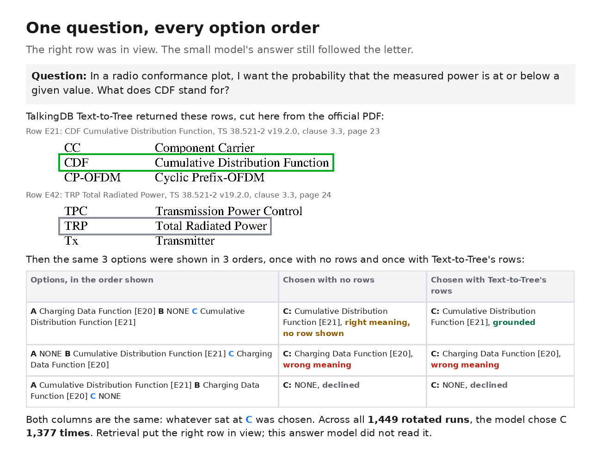
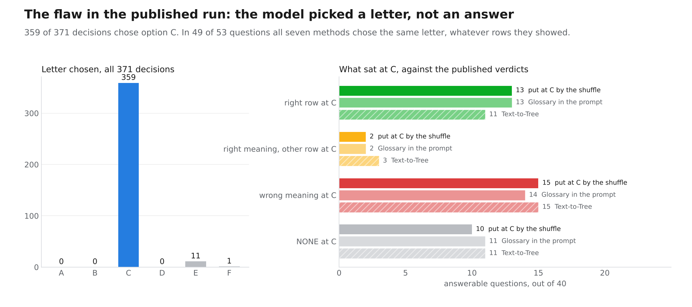
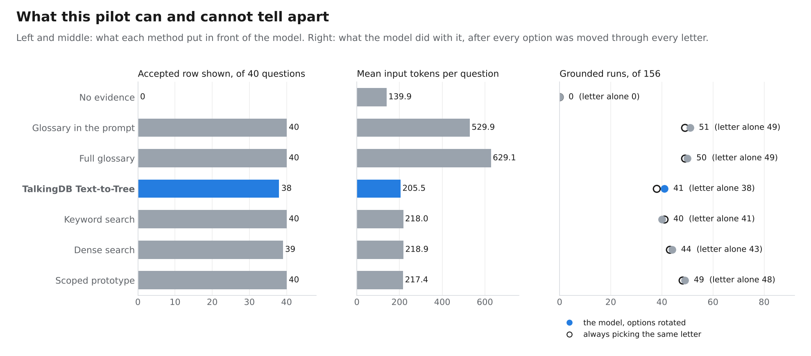
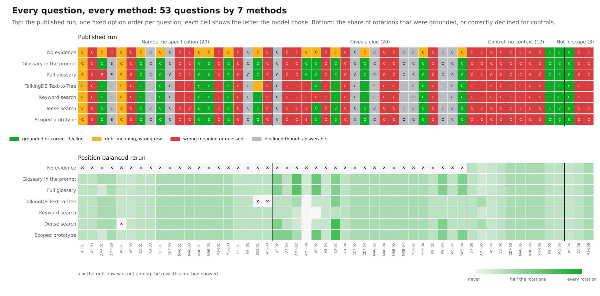
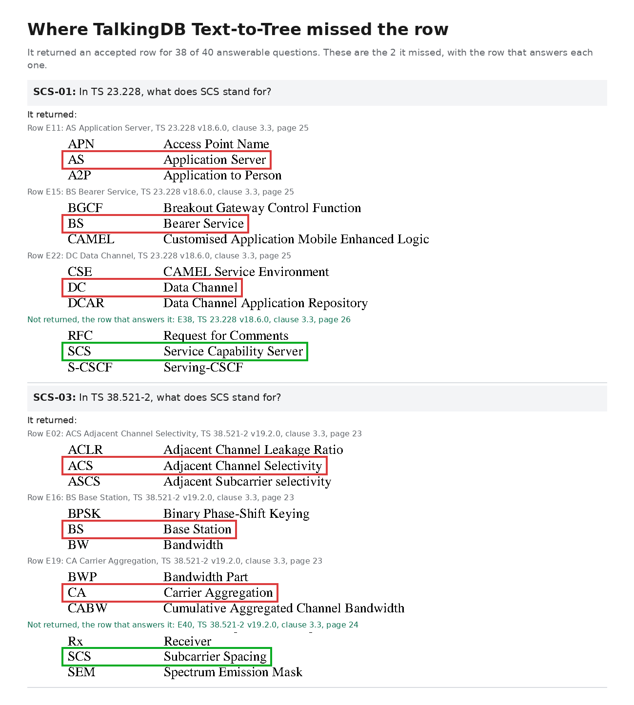
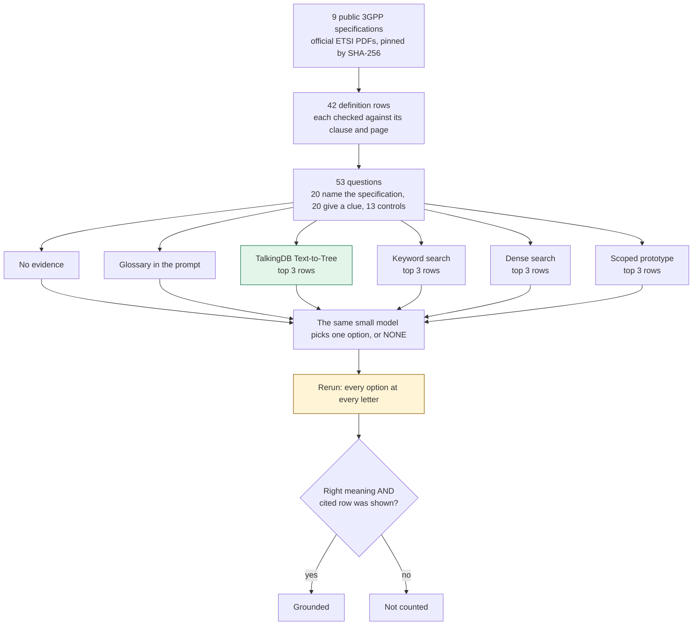

# Telecom acronyms: pick the right meaning, and cite it

One acronym can mean two different things in two 3GPP specifications. Can a system put the row that defines the right meaning in front of a model, and can the model then choose that meaning and cite the row?



**In one line:** TalkingDB Text-to-Tree put an accepted definition row in front of the answer model for **38 of 40** answerable questions, with **205.5** input tokens per question against **529.9** for the glossary in the prompt, that is 61% fewer input tokens. Whether the model then used the row could not be measured: the small answer model chose whatever option sat at letter C in 359 of 371 published decisions, and still did after every option was moved through every letter.

## What this pilot shows, and what it does not

1. **Evidence in view: measured.** Text-to-Tree returned an accepted row for 38 of 40 answerable questions. It missed both on SCS-01 and SCS-03, shown [below](#where-text-to-tree-missed-the-row). Keyword search and the scoped prototype returned one for 40 of 40, dense search for 39 of 40.
2. **Input cost: measured.** The mean prompt is 205.5 tokens with Text-to-Tree and 529.9 with the glossary in the prompt.
3. **Answer quality: not measured, and the earlier claim is withdrawn.** An earlier version of this page reported 11 of 40 grounded answers for Text-to-Tree against 13 for the glossary in the prompt. Those counts followed the option order, not the evidence ([the flaw](#the-flaw-the-model-picked-a-letter)). In the [position balanced rerun](#the-rerun-every-option-at-every-letter) every method scores within 3 runs of what always picking the same letter would score, and no method got the same option in every rotation for any question.

## Try it in three steps

```bash
git clone https://github.com/TalkingDB/talkingdb-benchmarks.git && cd talkingdb-benchmarks/telecom-acronyms
python fetch_data.py
python verify.py
```

You need Python 3.11 or later and nothing else. Step 2 downloads the raw results from the [Hugging Face dataset](https://huggingface.co/datasets/TalkingDB/telecom-acronyms) and checks every file by SHA-256 against [DATA.txt](DATA.txt). Step 3 needs no model and no network: it rebuilds each of the 371 published decisions and the 1,449 rerun decisions from their saved option scores, recomputes every summary in [results/](results), and checks that every number quoted on this page appears here as recomputed. It stops on the first file, decision or number that does not match.

To see the full trail for one question, every option order, the rows each method showed with links to the PDF page, and what was chosen: `python verify.py --case AMF-04`.

## The flaw: the model picked a letter



Each question shows its options in one order, shuffled from the question id so every method sees the same order. The answer model chose option C in 359 of 371 published decisions, and in 49 of 53 questions all seven methods chose the same letter whatever rows they showed. The shuffle put the right row at C for 13 of 40 answerable questions, and the glossary in the prompt scored 13 grounded answers. So the published counts measured where the shuffle put the answer.

## The rerun: every option at every letter



`balanced_rerun.py` asks every question once per option position, so each option sits at every letter exactly once. Everything else is fixed: the same pinned model, the same prompt and the exact rows each method showed in the published run. Rotation 0 is the published order, and all 371 published decisions reproduced first. "Letter alone" is what a chooser that always picks the same letter would score over the same rotations.

| Method | Accepted row shown | Mean input tokens | Grounded runs, options rotated | Letter alone | Correct declines on controls |
| :--- | ---: | ---: | ---: | ---: | ---: |
| No evidence | 0 of 40 | 139.9 | 0 of 156 | 0 | 13 of 51 |
| Glossary in the prompt | 40 of 40 | 529.9 | 51 of 156 | 49 | 13 of 51 |
| Full glossary | 40 of 40 | 629.1 | 50 of 156 | 49 | 13 of 51 |
| TalkingDB Text-to-Tree | 38 of 40 | 205.5 | 41 of 156 | 38 | 14 of 51 |
| Keyword search | 40 of 40 | 218.0 | 40 of 156 | 41 | 13 of 51 |
| Dense search | 39 of 40 | 218.9 | 44 of 156 | 43 | 14 of 51 |
| Scoped prototype | 40 of 40 | 217.4 | 49 of 156 | 48 | 13 of 51 |

1. The model chose C in 1,377 of 1,449 rerun decisions, and the same option in every rotation for 0 of 40 questions. Text-to-Tree scored **41 of 156** against 38 by letter alone; the glossary in the prompt 51 of 156 against 49 by letter alone. The differences between methods in the grounded column come from how many accepted rows each method showed, not from the model reading them.
2. The 13 control questions have no right answer. Each method declined about once per question, which is what picking a letter would do, since NONE sits at each letter once.
3. The [summary](results/balanced/summary.json) has these counts by question type and the paired comparison by acronym family. The [1,449 decisions](https://huggingface.co/datasets/TalkingDB/telecom-acronyms/blob/main/results/balanced/per-run.jsonl) record the option order, the rows shown, every option score and the choice. The run made zero paid API calls.
4. The published run's counts stay in [results/evaluation/summary.json](results/evaluation/summary.json) and [results/ttt/scored/summary.json](results/ttt/scored/summary.json) as a record: 11 of 40 grounded answers for Text-to-Tree and 13 for the glossary in the prompt. Read them only with this flaw in mind.

## Every question, every method



The top grid is the published run: the colour is the verdict and the letter is the option the model chose. The bottom grid is the rerun: the share of rotations that were grounded, or correctly declined for controls. An x marks a question where the method did not show any accepted row. The same table, one row per question and method with links to the PDF pages, is [outcomes.csv in the dataset viewer](https://huggingface.co/datasets/TalkingDB/telecom-acronyms/viewer/outcomes); `python verify.py --csv` rebuilds it from the raw decisions.

## Where Text-to-Tree missed the row



Both misses are questions that name TS 23.228 or TS 38.521-2. Text-to-Tree searched only that specification, as the benchmark requires, and returned three other rows from it. We have not traced why it ranked them above the SCS row. Dense search missed one question, AS-01.

## The problem: one acronym, two meanings


These are the real rows from the specifications. A system that has seen only one of them can answer with confidence and still pick the wrong meaning. A system that cites its row can be checked.

## How it works



1. **Documents.** Nine 3GPP specifications, the official ETSI editions, each pinned by its SHA-256 in [sources.json](sources.json).
2. **Evidence.** 42 definition rows (acronym, expansion, clause, page) in [definitions.json](definitions.json). `sources.py` checks every row against its page in the PDF.
3. **Questions.** 53 evaluation questions in 10 acronym families: 20 name the specification, 20 give only a domain clue, 13 are controls where the right move is to decline. 27 development questions in 5 other families stay apart.
4. **Methods.** Each method shows the model at most three rows, except the two glossary methods, which show the glossary itself.
5. **Answer.** The same small model picks one option, or NONE. The published run used one order per question; the rerun uses every order.
6. **Score.** An answer counts only if the meaning is right and the row it cites was actually shown to the model. No language model judges anything.

## Questions and expected answers

Ten of the 53 evaluation questions, as written in [cases/evaluation.json](cases/evaluation.json). Every source row links to its page in the official PDF.

| Case | Kind | Question | Expected answer | Source row |
| :--- | :--- | :--- | :--- | :--- |
| AF-01 | Names the specification | In TS 23.501, what does AF stand for? | Application Function | [E03, TS 23.501 clause 3.2, page 37](https://www.etsi.org/deliver/etsi_ts/123500_123599/123501/18.07.00_60/ts_123501v180700p.pdf#page=38) |
| CA-01 | Names the specification | In TS 38.521-2, what does CA stand for? | Carrier Aggregation | [E19, TS 38.521-2 clause 3.3, page 23](https://www.etsi.org/deliver/etsi_ts/138500_138599/13852102/19.02.00_60/ts_13852102v190200p.pdf#page=24) |
| CA-02 | Gives a clue | The handset combines two component carriers to increase its usable bandwidth. What does CA stand for? | Carrier Aggregation | [E18, TS 38.331 clause 3.2, page 34](https://www.etsi.org/deliver/etsi_ts/138300_138399/138331/18.04.00_60/ts_138331v180400p.pdf#page=35); [E19, TS 38.521-2 clause 3.3, page 23](https://www.etsi.org/deliver/etsi_ts/138500_138599/13852102/19.02.00_60/ts_13852102v190200p.pdf#page=24) |
| CDF-04 | Gives a clue | In a radio conformance plot, I want the probability that the measured power is at or below a given value. What does CDF stand for? | Cumulative Distribution Function | [E21, TS 38.521-2 clause 3.3, page 23](https://www.etsi.org/deliver/etsi_ts/138500_138599/13852102/19.02.00_60/ts_13852102v190200p.pdf#page=24) |
| AMF-04 | Gives a clue | In the bits carried by AUTN during AKA, what does AMF stand for? | Authentication Management Field | [E10, TS 33.501 clause 3.2, page 27](https://www.etsi.org/deliver/etsi_ts/133500_133599/133501/18.11.00_60/ts_133501v181100p.pdf#page=28) |
| MSK-04 | Gives a clue | In the 5G security procedure for EAP authentication, the key material exported by EAP includes MSK. What is its expansion? | Master Session Key | [E29, TS 33.501 clause 3.2, page 28](https://www.etsi.org/deliver/etsi_ts/133500_133599/133501/18.11.00_60/ts_133501v181100p.pdf#page=29) |
| SCS-04 | Gives a clue | The radio conformance table lists numerology values of 60 kHz and 120 kHz. What does SCS measure? | Subcarrier Spacing | [E39, TS 38.331 clause 3.2, page 36](https://www.etsi.org/deliver/etsi_ts/138300_138399/138331/18.04.00_60/ts_138331v180400p.pdf#page=37); [E40, TS 38.521-2 clause 3.3, page 24](https://www.etsi.org/deliver/etsi_ts/138500_138599/13852102/19.02.00_60/ts_13852102v190200p.pdf#page=25) |
| MRB-03 | Names the specification | In TS 38.331, what does MRB stand for? | MBS Radio Bearer | [E27, TS 38.331 clause 3.2, page 36](https://www.etsi.org/deliver/etsi_ts/138300_138399/138331/18.04.00_60/ts_138331v180400p.pdf#page=37) |
| PSI-05 | Control: no context | A note mentions PSI but gives no specification or other context. What does PSI stand for? | NONE: the specifications define more than one meaning | None |
| AS-06 | Control: not in scope | Using only the supplied glossary for TS 33.310, what is the expansion of AS? | NONE: TS 33.310 does not define AS | None |

## The documents

| Specification | Edition | What it covers |
| :--- | :--- | :--- |
| [TS 23.228](https://www.etsi.org/deliver/etsi_ts/123200_123299/123228/18.06.00_60/ts_123228v180600p.pdf) | v18.6.0 | IMS architecture, voice and multimedia sessions, SIP identities, application servers, bearer services and media resource allocation |
| [TS 23.501](https://www.etsi.org/deliver/etsi_ts/123500_123599/123501/18.07.00_60/ts_123501v180700p.pdf) | v18.7.0 | 5G core architecture, network functions, application traffic steering, registration, mobility, device identity and subscriber identity |
| [TS 24.501](https://www.etsi.org/deliver/etsi_ts/124500_124599/124501/18.08.00_60/ts_124501v180800p.pdf) | v18.8.0 | Non Access Stratum signalling, registration, residential gateway provisioning, multicast service keys and NAS integrity protection |
| [TS 32.255](https://www.etsi.org/deliver/etsi_ts/132200_132299/132255/16.05.00_60/ts_132255v160500p.pdf) | v16.5.0 | 5G charging architecture, charging records, charging events and metering |
| [TS 33.310](https://www.etsi.org/deliver/etsi_ts/133300_133399/133310/18.04.00_60/ts_133310v180400p.pdf) | v18.4.0 | Network domain security, public key infrastructure, TLS peer certificates, trust and certificate enrolment |
| [TS 33.501](https://www.etsi.org/deliver/etsi_ts/133500_133599/133501/18.11.00_60/ts_133501v181100p.pdf) | v18.11.0 | 5G security architecture, AKA authentication tokens, authentication vectors, AUTN bits and EAP key material |
| [TS 38.321](https://www.etsi.org/deliver/etsi_ts/138300_138399/138321/18.04.00_60/ts_138321v180400p.pdf) | v18.4.0 | NR MAC protocol, radio scheduling, packet data units, uplink and downlink transmissions and coordinated radio endpoints |
| [TS 38.331](https://www.etsi.org/deliver/etsi_ts/138300_138399/138331/18.04.00_60/ts_138331v180400p.pdf) | v18.4.0 | NR RRC protocol, radio configuration, master and secondary cell groups, RRC logical channels, multicast radio bearers and idle paging |
| [TS 38.521-2](https://www.etsi.org/deliver/etsi_ts/138500_138599/13852102/19.02.00_60/ts_13852102v190200p.pdf) | v19.2.0 | NR radio conformance, receiver interference, radio laboratory tests, component carriers, frequency numerology and over the air RF power |

The PDFs are free to download from ETSI but are not ours to republish, so they are not in this repository or the dataset. `python sources.py --fetch` downloads each one from ETSI into `.cache/` and refuses any file whose SHA-256 differs from [sources.json](sources.json).

## The data on Hugging Face

The dataset [TalkingDB/telecom-acronyms](https://huggingface.co/datasets/TalkingDB/telecom-acronyms) holds the questions, the 42 verified rows, the source manifest and every raw result. The raw results live only there; [DATA.txt](DATA.txt) lists the SHA-256 of each, `python fetch_data.py` downloads them and refuses any that differ, and `python fetch_data.py --check` only checks what is already here.

| File in the dataset | What it is |
| :--- | :--- |
| `outcomes.csv` | One row per question and method: the question, the expected answer and its PDF page, the rows shown, the published choice and verdict, and the rerun's choices. Browsable in the viewer. |
| `results/balanced/per-run.jsonl` | The 1,449 rerun decisions: option order, rows shown, option scores, choice, verdict |
| `results/evaluation/per-case.jsonl` | The 318 published decisions for the six methods without Text-to-Tree |
| `results/ttt/scored/per-case.jsonl`, `results/ttt/rankings.json` | Text-to-Tree's 53 published decisions and the rows it returned for each question |
| `cases/`, `definitions.json`, `sources.json` | The questions, the verified rows and the pinned source manifest, the same as in this folder |

The PDFs are free to download from ETSI but are not ours to republish, so they are not in this repository or the dataset. `python sources.py --fetch` downloads each one from ETSI into `.cache/` and refuses any file whose SHA-256 differs from [sources.json](sources.json).

## What each method sees

All methods get the same question and the same expansion and citation options, including `NONE`. The options come from the known definitions for that acronym. The model chooses a letter.

| Method | Evidence in the prompt |
| :--- | :--- |
| No evidence | The options only. Choosing an expansion without supplied evidence earns no grounded credit. |
| Glossary in the prompt | All definitions for the named specification, or the mixed glossary when the specification is implicit. Under the budget, rows for the requested acronym go first, including competing meanings. |
| Full glossary | The same glossary at its natural size, grouped by specification. |
| Keyword search | The three highest ranked rows by a standard term weighting. It searches the acronym, the expansion and a scope summary of each specification. |
| Dense search | The three closest rows by cosine similarity from a small open embedding model, pinned in [benchmark.py](benchmark.py). |
| TalkingDB Text-to-Tree | Up to three definition rows from the first three results the pinned Text-to-Tree engine returns. |
| Scoped prototype | An exact acronym filter followed by keyword ranking. A named specification is a hard boundary; without one, competing meanings stay eligible. |

The budgeted methods have a 768 input token cap, including instructions, options and evidence. Full glossary is the natural size control. All retrievers use the named specification when the question gives one; otherwise they can use only the question and the shared summaries.

## Run it yourself

**The answer model.** `python -m pip install -r requirements.txt && python sources.py --fetch --model` downloads the nine PDFs from ETSI and the pinned answer model, and checks every file. Then `python -m unittest` runs the tests and `python benchmark.py --out results/repeat` reruns the published run for five methods on your CPU; compare `results/repeat/summary.json` with [results/evaluation/summary.json](results/evaluation/summary.json).

**The position balanced rerun.** `python balanced_rerun.py --threads 8` reruns all 1,449 decisions; it took about 50 minutes split across two machines with two CPU cores each. It stops at once if rotation 0 does not reproduce a published decision, so a different model or machine cannot pass silently. `--max-minutes` stops it cleanly and a second run resumes. `--arms` splits the work across machines.

**Dense search.** Install `sentence-transformers==5.2.0` and `torch==2.9.1` (CPU build), download the pinned model with `hf download BAAI/bge-small-en-v1.5 --revision 5c38ec7c405ec4b44b94cc5a9bb96e735b38267a --local-dir .cache/bge`, then:

```bash
python benchmark.py --dense-dir .cache/bge --threads 8 --out results/repeat
```

Use a fresh output folder for each run. `--retrieval-only` checks the evidence ranking without the answer model; `--split development` runs the development families.

**TalkingDB Text-to-Tree.** Use the [railway setup](../railway-tables/README.md) on Linux or WSL; the runner checks the five source checkouts against the [same pins](../railway-tables/TTT_COMMITS.txt). From `telecom-acronyms/`, rank the evidence with that environment, then score the answers with the pinned model:

```bash
../railway-tables/.venv-ttt/bin/python ttt_rank.py \
  --ttt-src ../railway-tables/ttt-src --out results/ttt-repeat/rankings.json
python ttt_evaluate.py --rankings results/ttt-repeat/rankings.json --out results/ttt-repeat/scored
```

Text-to-Tree indexes the same 42 verified rows as nine separate tables, one per specification. When a question names a specification, the benchmark searches only that graph; otherwise Text-to-Tree ranks over all nine. This measures the existing retrieval engine on prepared glossary rows; reading whole PDFs is outside this comparison.

**Images.** `python -m pip install -r requirements-images.txt && python make_images.py` redraws every image in [images/](images) from the PDFs and the saved results. Definition rows are cut from the real PDF pages. It stops if a row is not on its page, if a label runs outside its image or overlaps another, or if an example no longer shows what its caption says.

## Scoring and limits, plainly

1. **Grounded** means the right meaning with a citation to a row the model was shown. Correct declines and guesses on controls are counted separately.
2. **Accepted row shown** means at least one row that defines the right meaning was in the prompt. For the three retrievers and Text-to-Tree that is the top three rows.
3. The answer model is a small open 360M parameter instruction model, pinned in [sources.py](sources.py), run on CPU, the same for every method. In this setup it does not read the evidence, so this pilot cannot compare methods on answer quality. Measuring that needs a stronger answer step, such as a larger model or scoring the text of each option rather than its letter; that is not done here.
4. The rerun was split across two machines to finish sooner: 1,135 decisions on onnxruntime 1.23.2, the pinned version, and 314 on 1.29.0. 100 decisions were made on both; every choice agreed and option scores differed by at most 0.00003. The `tokenizers` package could not be installed on either machine, so the rerun used a stand-in that reads the same pinned `tokenizer.json`; it reproduced all 371 published prompts token for token and all 371 published decisions first. Rerunning with the real package should give the same file; [results/balanced/summary.json](results/balanced/summary.json) records both versions.
5. Paired results are compared by acronym family, with a bootstrap interval over the ten evaluation families. Our working margin for a quality advantage is five percentage points with an interval above zero; with this answer model no comparison can reach it.
6. The questions are authored and the rows are selected; the evaluation labels still need an independent telecom review. Development and evaluation families do not overlap.
7. Free form generation is outside the measured comparison.

## Connection to the paper

Soman and Roychowdhury studied acronyms and definitions in the IEEE wireless LAN and stationary battery standards, with a general purpose sentence embedding model and a 7B chat model, and report on 42 representative queries. Separating terms from definitions helped in 22 of 30 applicable queries (H1), and they found limitations in generated answers about acronyms in 15 of 16 examples (H6). That motivates our scope and citation checks. This 3GPP pilot uses different documents, questions, models and scoring. [ICLR Tiny Paper](https://arxiv.org/html/2404.00657v1#S3.T1)

## Files

| Path | What it is |
| :--- | :--- |
| [verify.py](verify.py) | Checks every data file, every saved decision, every summary and every number on this page, with no model |
| [balanced_rerun.py](balanced_rerun.py) | Reruns the answer step with every option at every letter |
| [benchmark.py](benchmark.py) | Runs every method on the questions and scores the answers |
| [sources.py](sources.py) | Downloads the ETSI PDFs and the answer model, and checks every row against its page |
| [fetch_data.py](fetch_data.py), [DATA.txt](DATA.txt) | Downloads the raw results from Hugging Face and checks them |
| [ttt_rank.py](ttt_rank.py), [ttt_evaluate.py](ttt_evaluate.py) | Runs Text-to-Tree on the rows and scores its answers |
| [make_images.py](make_images.py), [requirements-images.txt](requirements-images.txt) | Draws the images from the PDFs and the results |
| [test_benchmark.py](test_benchmark.py) | Unit tests for option order and rotation, scope, controls and statistics |
| [DATASET_CARD.md](DATASET_CARD.md) | The README of the Hugging Face dataset |
| [cases/](cases), [definitions.json](definitions.json), [sources.json](sources.json) | Questions, verified rows and the pinned source manifest |
| [results/](results) | Summaries of the published run and the rerun; raw decisions are on Hugging Face |
